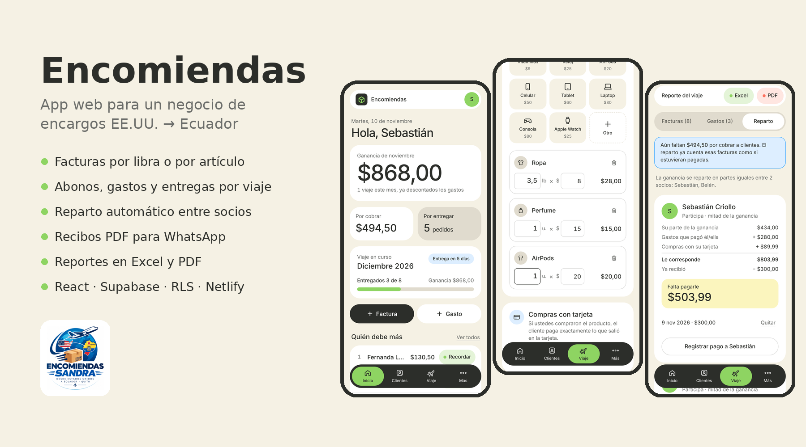
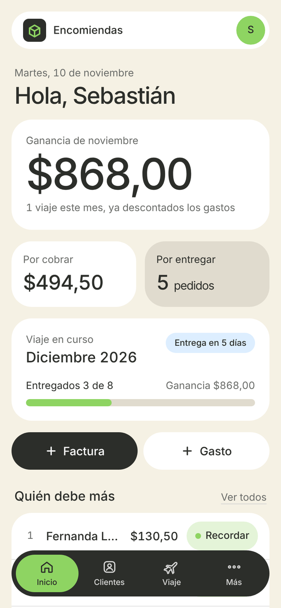
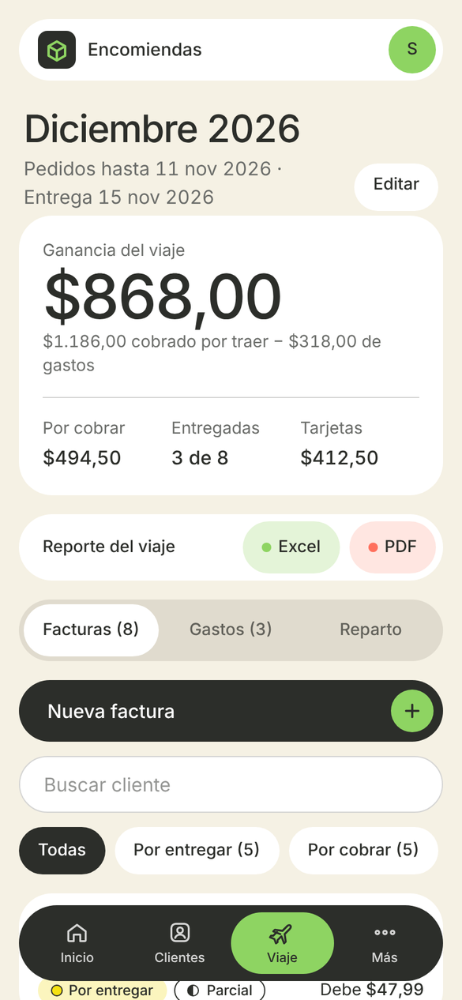
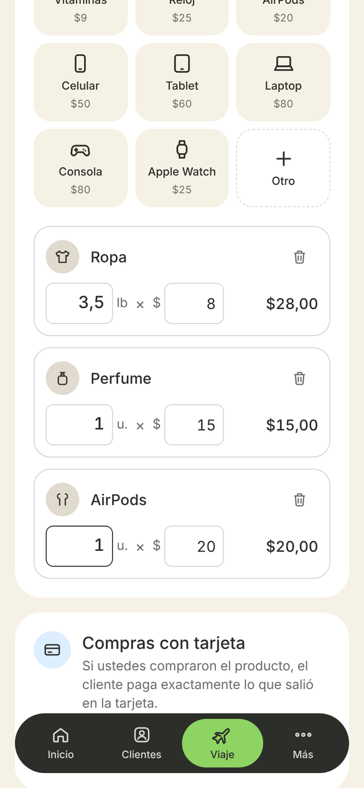
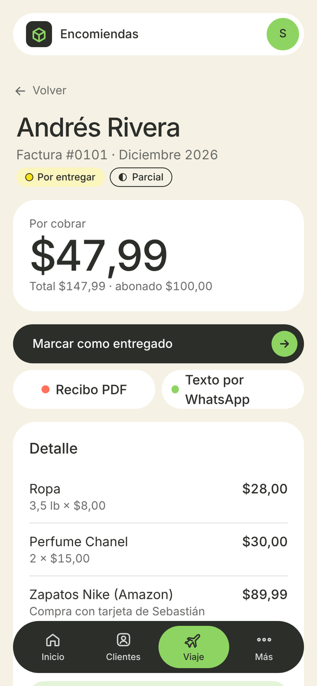
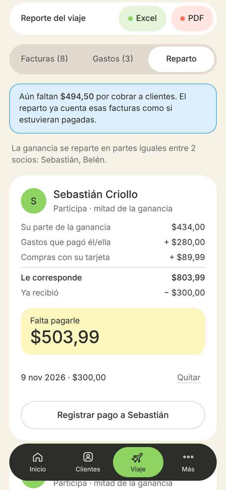
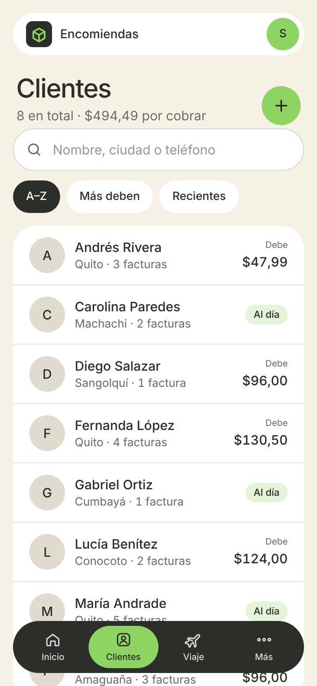
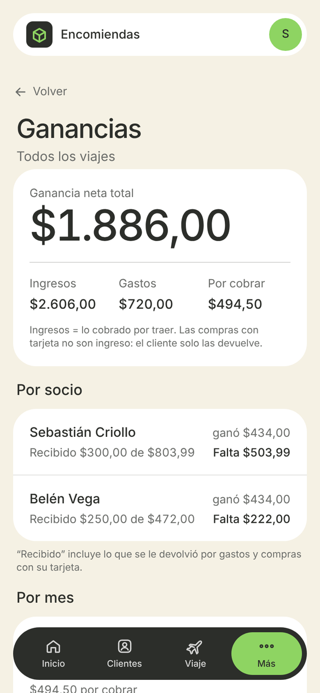
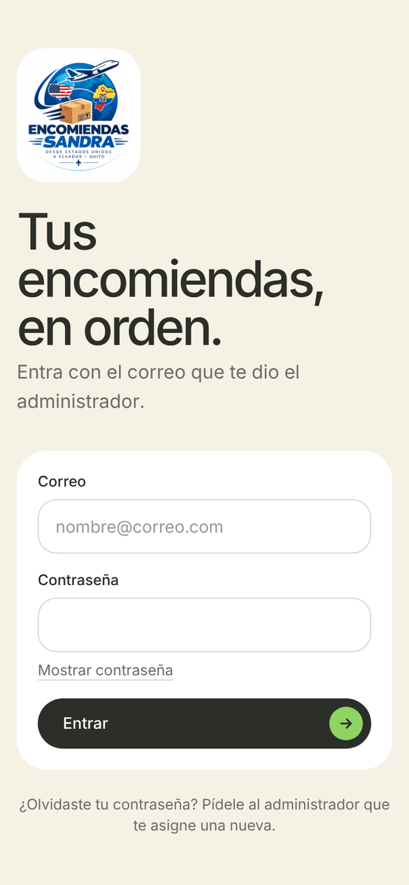

# Encomiendas



Aplicación web **mobile-first** que uso con mi familia para administrar nuestro negocio de encargos desde Estados Unidos hacia Ecuador (*Encomiendas Sandra*). Varios socios registran clientes, facturas, abonos y gastos desde el celular, y la app calcula sola cuánto se debe, cuánto se ganó en cada viaje y cuánto le corresponde a cada socio.

**Stack:** React 19 · Vite · Tailwind CSS 4 · Supabase (PostgreSQL, Auth, Edge Functions) · Netlify

> Las capturas usan datos ficticios. La app en producción es privada porque contiene datos reales de clientes.

---

## El problema

- Los pedidos de cada viaje se llevaban en hojas de cálculo, y con pagos parciales no era fácil saber **quién debía cuánto**.
- Se cobra por **libra** (ropa, zapatos) o por **artículo** (perfumes, celulares…), y a veces se compra el producto con la tarjeta de un socio. Calcular la ganancia real de cada viaje era tedioso.
- En cada viaje participan socios distintos, y cada uno pone dinero de su bolsillo en pasajes y transporte. Hacía falta calcular el reparto devolviendo primero lo que cada uno gastó.

## Funcionalidades

| Módulo | Qué hace |
|---|---|
| **Autenticación y roles** | Login con correo. Roles *admin* y *socio*; el admin crea cuentas, da o quita acceso y otorga el permiso de "manejar reparto". |
| **Clientes** | Buscador sin tildes (por nombre, ciudad o teléfono), detección de duplicados, historial de facturas, saldo pendiente y botón de WhatsApp con recordatorio de pago prellenado. |
| **Viajes** | Agrupan facturas y gastos. El viaje "en curso" se abre directo desde la barra inferior. |
| **Facturas** | Se arman tocando la lista de precios (por libra o por unidad), con líneas libres y *compras con tarjeta* que no cuentan como ganancia. Total y ganancia se calculan en vivo. El cliente se puede crear sin salir de la factura. |
| **Abonos y entregas** | Pagos parciales con método y quién recibió el dinero; estado de pago calculado (pendiente / parcial / pagado). |
| **Gastos** | Pasajes, taxis, metro, etc., registrando qué socio los pagó. |
| **Reparto** | Ganancia del viaje dividida en partes iguales entre los socios participantes, más el reembolso de lo que cada uno puso. Registro de pagos a socios y saldo pendiente. |
| **Dashboard** | Ganancia del mes, por cobrar, pedidos por entregar, avance del viaje y "quién debe más". |
| **Recibo PDF** | Recibo con el logo del negocio para el cliente (sin datos internos). En el celular se comparte directo a WhatsApp con la Web Share API. |
| **Reportes** | Reporte del viaje en **Excel** (3 hojas con fórmulas) y **PDF** (tablas de clientes, gastos y reparto). |
| **Instalable (PWA)** | Manifest e íconos para agregarla a la pantalla de inicio como una app. |

## Capturas

| Inicio | Viaje | Nueva factura | Factura |
|---|---|---|---|
|  |  |  |  |
| **Reparto** | **Clientes** | **Ganancias** | **Login** |
|  |  |  |  |

## Decisiones técnicas

- **Seguridad en la base de datos, no en el frontend.** Todas las tablas tienen *Row Level Security*. Funciones `security definer` (`es_miembro()`, `es_admin()`, `puede_repartir()`) deciden quién lee, escribe o borra. El frontend solo usa la clave pública, así que las reglas se cumplen aunque alguien modifique el JavaScript.
- **Operaciones privilegiadas en una Edge Function.** Crear usuarios y restablecer contraseñas requiere la clave secreta, que vive solo en la función `gestionar-usuarios`. La función valida el token de quien la llama y comprueba que sea admin.
- **Cálculos en vistas SQL.** Saldos, estado de pago, ganancia y reparto se calculan en vistas (`v_facturas`, `v_viajes`, `v_clientes`, `v_reparto`) con `security_invoker`, para que respeten RLS. Nada calculado se guarda duplicado, así que no puede quedar desactualizado.
- **Guardado atómico.** Una factura con todas sus líneas se guarda con una función RPC (`guardar_factura`) en una sola transacción: se guarda todo o nada.
- **Auditoría automática.** Triggers llenan `creado_por` / `modificado_por` y copian cada cambio a una tabla `historial` con el antes y el después en JSON.
- **Rendimiento.** Las librerías pesadas (jsPDF, ExcelJS) se cargan con `import()` dinámico solo cuando se genera un documento.
- **Diseño.** Sistema de tokens propio en Tailwind (`@theme`), botones de al menos 48 px para uso con el dedo, estados que se distinguen por forma y no solo por color, e interfaz pensada para personas no técnicas.
- **Migraciones probadas.** Cada script SQL se probó en un PostgreSQL local con *stubs* de `auth`, ejecutando casos de permisos (socio sin permiso, usuario anónimo, último admin) antes de llevarlo a producción.

## Modelo de datos

```
perfiles ─┬─< participantes_viaje >─ viajes ─┬─< facturas >─ clientes
          │                                  │      ├─< items_factura >─ tarifas
          │                                  │      ├─< compras_tarjeta
          │                                  │      └─< abonos
          │                                  ├─< gastos (pagado_por → perfiles)
          └─< pagos_socios ──────────────────┘
historial (auditoría) · configuracion (datos del negocio)
```

## Estructura

```
encomiendas/
├─ supabase/
│  ├─ schema.sql, 02…05_*.sql        ← esquema, RLS, vistas, triggers (en orden)
│  ├─ 99_limpiar_datos_prueba.sql    ← vacía los datos operativos
│  └─ functions/gestionar-usuarios/  ← Edge Function (Deno)
├─ src/
│  ├─ lib/        ← cliente Supabase, formato, teléfono, recibo PDF, reportes
│  ├─ context/    ← sesión, perfil y permisos
│  ├─ components/ ← Layout, componentes base, íconos
│  └─ pages/      ← Inicio, Clientes, Viajes, Facturas, Reparto, Ganancias…
├─ public/        ← logo, íconos y manifest (PWA)
└─ netlify.toml   ← build, redirects SPA y cabeceras de seguridad
```

## Cómo ejecutarlo

**Requisitos:** Node.js 22 y un proyecto gratuito en [Supabase](https://supabase.com).

1. **Base de datos.** En Supabase → SQL Editor, ejecuta en orden: `schema.sql`, `02_clientes.sql`, `03_viajes_facturas.sql`, `04_reparto.sql` y `05_participantes.sql`.
2. **Autenticación.** En Authentication, desactiva el registro público y *Confirm email*. Crea tu usuario en *Users → Add user*; el primero queda como admin.
3. **Edge Function.** Crea `gestionar-usuarios` con el código de `supabase/functions/gestionar-usuarios/index.ts` y desactiva *Verify JWT with legacy secret*.
4. **Variables.** Copia `.env.example` a `.env` con la URL y la clave **pública** del proyecto.
5. **Correr la app:**
   ```bash
   npm install
   npm run dev
   ```

**Despliegue:** importa el repositorio en Netlify y agrega `VITE_SUPABASE_URL` y `VITE_SUPABASE_ANON_KEY` como variables de entorno.

## Roles y permisos

| | Admin | Socio con permiso de reparto | Socio |
|---|---|---|---|
| Ver todo el negocio | ✔ | ✔ | ✔ |
| Clientes, viajes, facturas, abonos, gastos | ✔ | ✔ | ✔ |
| Registrar pagos a socios y elegir participantes | ✔ | ✔ | ✘ |
| Borrar registros | ✔ | ✘ | ✘ |
| Socios, precios, datos del negocio, historial | ✔ | ✘ | ✘ |

---

**Autor:** Sebastián Criollo, estudiante de Ingeniería de Software en la Universidad de las Fuerzas Armadas ESPE.
[GitHub](https://github.com/SebastianCriollo) · [LinkedIn](https://www.linkedin.com/in/sebastiancriollo)
